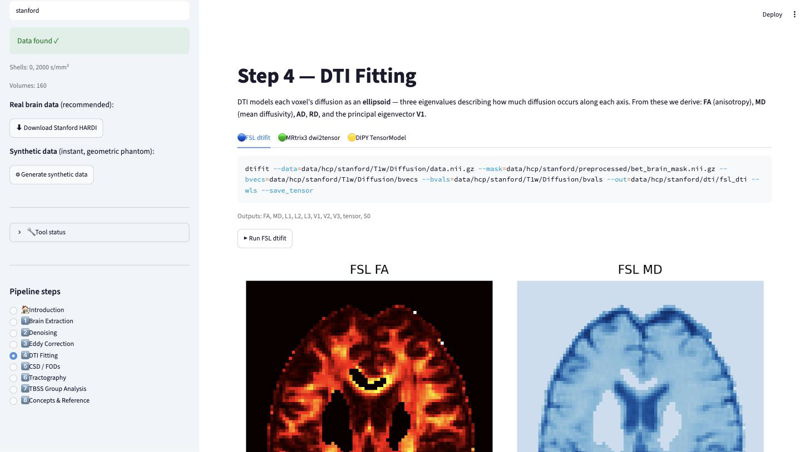
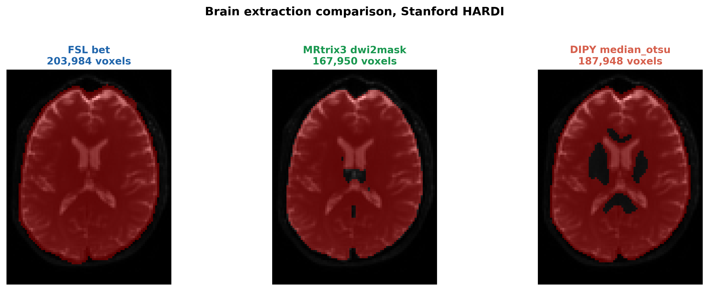
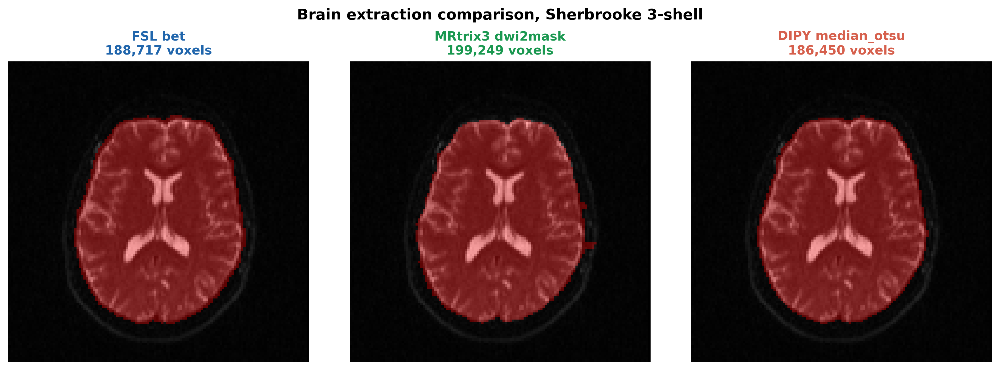
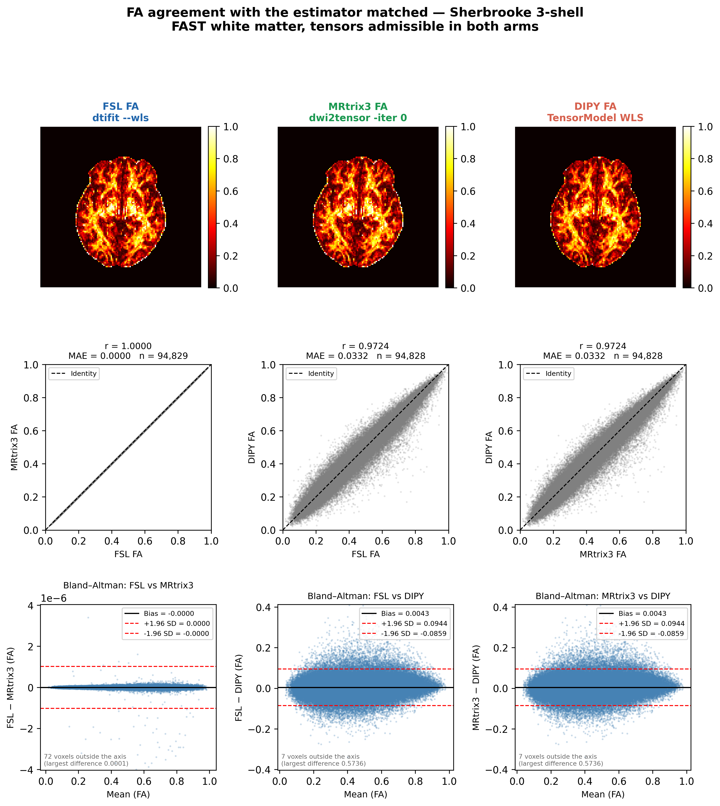
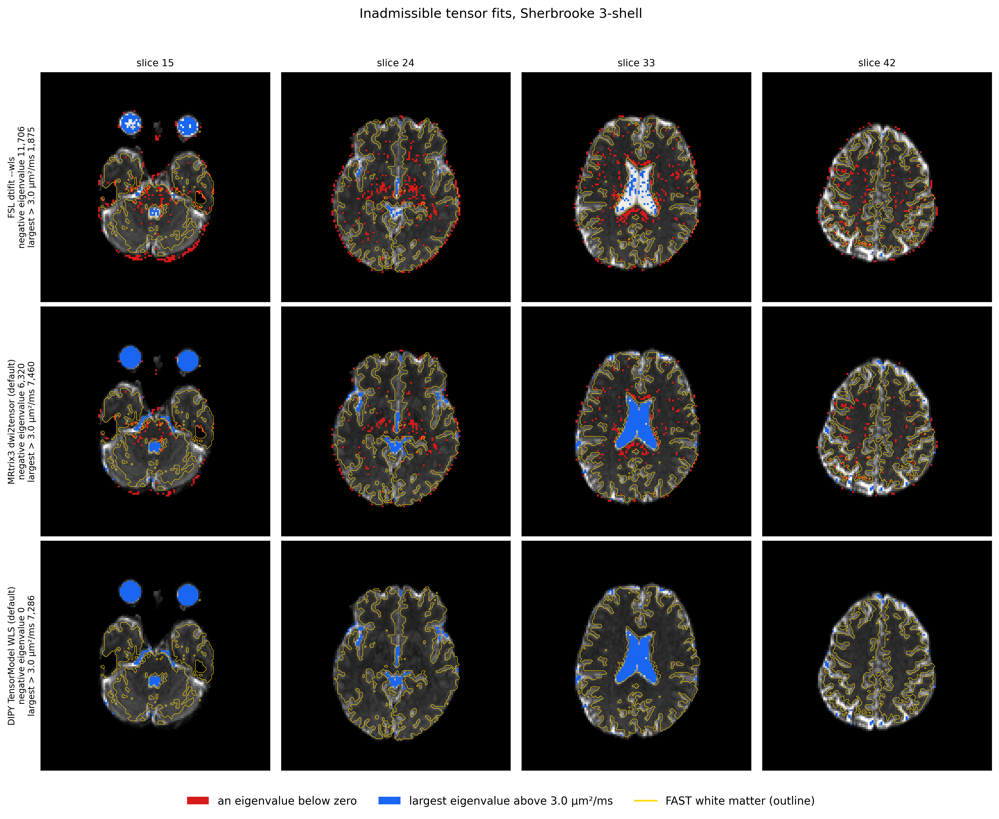

# Supplementary Material

**Diffusion MRI toolkits differ in which estimator they use, not in how they implement the tensor fit**

Busra Mutlu Ipek, Department of Neuroimaging, King's College London

## S1. The execution environment

The comparison in the main text depends on running FSL, MRtrix3 and DIPY on byte-identical input. All three are installed in one Docker container (Merkel, 2014). The container also serves an interactive Streamlit interface (Streamlit Inc., 2019), which presents each pipeline stage in the three toolkits side by side (Supplementary Figure S1). The interface is described here for completeness; it is not evaluated in the article.

### Container build

The Dockerfile uses a two-stage build. The first stage copies MRtrix3 3.0.8 from the official `mrtrix3/mrtrix3` image, pinned by digest so that a later rebuild reproduces the same binaries. The second starts from `ubuntu:22.04`, installs FSL with the official `fslinstaller.py` (version 6.0.7 in the image used here) and copies MRtrix3 from the first stage. It then installs the Python 3.12 stack, including DIPY 1.12.1, NumPy 1.26 and nibabel. The two stages avoid dependency conflicts between FSL and MRtrix3. The image is built and launched with

```bash
docker build --platform linux/amd64 -t dmri-rosetta .
docker run --rm --platform linux/amd64 -p 8501:7860 dmri-rosetta
```

after which the interface is available at `http://localhost:8501`. No neuroimaging software is required on the host.

### Pipeline coverage

The interface covers seven stages, each on its own page:

- brain extraction: FSL `bet`, MRtrix3 `dwi2mask`, DIPY `median_otsu`;
- MP-PCA denoising: MRtrix3 `dwidenoise`, DIPY `mppca` (Veraart et al., 2016);
- eddy-current and motion correction: FSL `eddy` (Andersson and Sotiropoulos, 2016), MRtrix3 `dwifslpreproc`, DIPY rigid-body `motion_correction`;
- tensor fitting: FSL `dtifit`, MRtrix3 `dwi2tensor`, DIPY `TensorModel`;
- constrained spherical deconvolution: MRtrix3 `dwi2fod` (Tournier et al., 2007; Jeurissen et al., 2014) and DIPY;
- tractography: MRtrix3 `tckgen` with iFOD2 (Tournier et al., 2010) and `tcksift2` (Smith et al., 2015), FSL `probtrackx2`, DIPY `LocalTracking`;
- tract-based spatial statistics (Smith et al., 2006).

When a toolkit lacks a stage, the page says so; for example, FSL has no denoiser. Each page shows the exact command, which can be copied and run outside the container. A reference section gives a guide to DTI metrics, a glossary and a command reference. Human Connectome Project data (Van Essen et al., 2013) can be used by those with access; the article uses only the two open datasets.

### Availability and requirements

| | |
|---|---|
| **Project name** | dMRI Rosetta Stone |
| **Project home page** | https://github.com/happybrotherhood/dmri-rosetta-stone |
| **Archived version** | Release v1.1.0, Zenodo concept DOI 10.5281/zenodo.22106454 |
| **Operating system** | Platform independent (Linux, macOS, Windows) via Docker |
| **Programming language** | Python 3.12 |
| **Other requirements** | Docker ≥ 20.10 |
| **Bundled toolkits** | FSL 6.0.7, MRtrix3 3.0.8, DIPY 1.12.1 |
| **Licence** | MIT |
| **Restrictions for non-academic use** | None imposed by this project. The bundled FSL is distributed under the FSL Licence, which restricts commercial use; MRtrix3 (MPL 2.0) and DIPY (BSD 3-clause) carry no such restriction. |

## S2. Brain extraction

Brain extraction was compared separately from tensor fitting and makes the opposite choice about input. Each tool was run on the input its algorithm is designed for, because that input is part of the algorithm being compared. FSL `bet` was run on the mean b = 0 image, MRtrix3 `dwi2mask` on the full series, and DIPY `median_otsu` on the full series with the b = 0 volumes indexed. Agreement between each pair of masks was measured with the Dice similarity coefficient (DSC). The tensor fits did not use the FSL or MRtrix3 masks; every arm was given one shared mask, generated with the same `median_otsu` settings.

Pairwise DSC was between 0.9009 and 0.9277 on Stanford and between 0.9058 and 0.9668 on Sherbrooke (Supplementary Table S1). The coefficients conceal how differently the algorithms behave. On Stanford the mask volumes spanned 21%, from 167,950 voxels (MRtrix3) to 203,984 (FSL); on Sherbrooke they spanned 7%, and MRtrix3 moved from the most conservative mask to the most inclusive. Disagreement concentrated at the cortical boundary and at the lateral ventricles, which `median_otsu` excluded and the other two retained (Supplementary Figures S2 and S3). A mask that includes the ventricles admits high-diffusivity, near-isotropic voxels into any subsequent statistics.

**Supplementary Table S1. Brain mask agreement.** Dice similarity coefficient for each pair of masks, and mask volume in voxels.

| Dataset | FSL vs. MRtrix3 | FSL vs. DIPY | MRtrix3 vs. DIPY | FSL voxels | MRtrix3 voxels | DIPY voxels |
|---|---|---|---|---|---|---|
| Stanford | 0.9024 | 0.9277 | 0.9009 | 203,984 | 167,950 | 187,948 |
| Sherbrooke | 0.9058 | 0.9668 | 0.9163 | 188,717 | 199,249 | 186,450 |

## S3. Agreement with the estimator matched, Sherbrooke

Supplementary Figure S4 repeats Figure 2 of the main text for the Sherbrooke data (b = 0 and b = 1000 s/mm² subset). FSL `--wls` and MRtrix3 `-iter 0` coincide (r = 1.0000, 95% limits of agreement ±0.0001 FA units), and both differ from DIPY WLS by the same amount (FA r = 0.8895, MAE 0.0505).

## S4. Phantom accuracy in the isotropic region

**Supplementary Table S2. Accuracy in the isotropic region of the phantoms.** True FA = 0, true MD = 0.90 µm²/ms; 5,408 voxels per region; Rician noise. SNR gives the nominal value of Table 6; this region had S₀ = 800, so its SNR was 24, 16 and 8. Bias is estimate minus truth; its standard error was at most 0.0011 for FA and 0.0010 for MD. Noise induces a positive FA bias in every arm, smallest with measured-signal weighting. Only measured-signal weighting underestimates MD by a substantial amount. MD in µm²/ms.

| SNR | Arm | Weights | FA bias | FA RMSE | MD bias | MD RMSE |
|---|---|---|---|---|---|---|
| 30 | FSL `--wls` / MRtrix3 `-iter 0` | measured | +0.0856 | 0.0898 | −0.0135 | 0.0260 |
|  | DIPY WLS (default) | predicted | +0.0860 | 0.0902 | 0.0000 | 0.0226 |
|  | MRtrix3 default | predicted | +0.0863 | 0.0905 | 0.0000 | 0.0226 |
|  | FSL default (OLS) | none | +0.0862 | 0.0904 | 0.0000 | 0.0226 |
| 20 | FSL `--wls` / MRtrix3 `-iter 0` | measured | +0.1275 | 0.1338 | −0.0296 | 0.0444 |
|  | DIPY WLS (default) | predicted | +0.1288 | 0.1350 | 0.0000 | 0.0341 |
|  | MRtrix3 default | predicted | +0.1297 | 0.1360 | 0.0000 | 0.0341 |
|  | FSL default (OLS) | none | +0.1296 | 0.1359 | 0.0000 | 0.0341 |
| 10 | FSL `--wls` / MRtrix3 `-iter 0` | measured | +0.2485 | 0.2602 | −0.1042 | 0.1217 |
|  | DIPY WLS (default) | predicted | +0.2535 | 0.2652 | −0.0012 | 0.0701 |
|  | MRtrix3 default | predicted | +0.2587 | 0.2705 | −0.0005 | 0.0703 |
|  | FSL default (OLS) | none | +0.2622 | 0.2752 | −0.0001 | 0.0706 |

## S5. Simulations

**Supplementary Table S3. Bias and error of the two weighting schemes on the real gradient tables.** Simplified simulation: axially symmetric tensors, true MD = 0.70 µm²/ms, random orientation, Rician noise, 10,000 voxels per condition. Each cell gives measured-signal weighting (FSL `--wls`, MRtrix3 `-iter 0`) / predicted-signal weighting (DIPY WLS), fitted to the same voxels. Bias is estimate minus truth; its Monte Carlo standard error was at most 0.0011. Three of the six simulated FA values are shown. `weighting_simulation.txt` in the repository gives all of them, for all four linear estimators, including the OLS and IWLS defaults of FSL and MRtrix3. Supplementary Table S4 gives every FA bin at each dataset's measured SNR. MD in µm²/ms.

| Protocol | SNR | True FA | FA bias, measured / predicted | FA RMSE, measured / predicted | MD bias, measured / predicted | MD RMSE, measured / predicted |
|---|---|---|---|---|---|---|
| Stanford (10 b = 0 + 150 at b = 2000) | 10 | 0.25 | −0.0462 / −0.0020 | 0.0634 / 0.0458 | −0.1146 / −0.0063 | 0.1165 / 0.0243 |
|  |  | 0.45 | −0.0994 / −0.0277 | 0.1083 / 0.0500 | −0.1227 / −0.0141 | 0.1245 / 0.0278 |
|  |  | 0.65 | −0.1194 / −0.0401 | 0.1255 / 0.0523 | −0.1383 / −0.0272 | 0.1400 / 0.0368 |
|  | 20 | 0.25 | −0.0215 / +0.0023 | 0.0317 / 0.0238 | −0.0367 / −0.0003 | 0.0383 / 0.0118 |
|  |  | 0.45 | −0.0399 / −0.0014 | 0.0455 / 0.0216 | −0.0414 / −0.0007 | 0.0430 / 0.0125 |
|  |  | 0.65 | −0.0442 / −0.0039 | 0.0477 / 0.0168 | −0.0504 / −0.0029 | 0.0519 / 0.0135 |
|  | 30 | 0.25 | −0.0103 / +0.0012 | 0.0188 / 0.0159 | −0.0170 / 0.0000 | 0.0186 / 0.0078 |
|  |  | 0.45 | −0.0197 / −0.0003 | 0.0245 / 0.0144 | −0.0200 / −0.0003 | 0.0215 / 0.0082 |
|  |  | 0.65 | −0.0217 / −0.0009 | 0.0245 / 0.0110 | −0.0249 / −0.0007 | 0.0263 / 0.0089 |
|  | 50 | 0.25 | −0.0038 / +0.0006 | 0.0101 / 0.0095 | −0.0064 / −0.0001 | 0.0078 / 0.0046 |
|  |  | 0.45 | −0.0074 / −0.0001 | 0.0113 / 0.0085 | −0.0074 / 0.0000 | 0.0088 / 0.0049 |
|  |  | 0.65 | −0.0082 / −0.0002 | 0.0105 / 0.0064 | −0.0095 / −0.0002 | 0.0108 / 0.0053 |
| Sherbrooke (1 b = 0 + 64 at b = 1000) | 10 | 0.25 | +0.0335 / +0.0371 | 0.0880 / 0.0855 | −0.0690 / +0.0003 | 0.1239 / 0.1035 |
|  |  | 0.45 | +0.0053 / +0.0163 | 0.0931 / 0.0874 | −0.0707 / +0.0012 | 0.1262 / 0.1050 |
|  |  | 0.65 | −0.0067 / +0.0071 | 0.0937 / 0.0837 | −0.0790 / −0.0028 | 0.1317 / 0.1063 |
|  | 20 | 0.25 | +0.0072 / +0.0097 | 0.0394 / 0.0395 | −0.0188 / −0.0005 | 0.0556 / 0.0523 |
|  |  | 0.45 | +0.0005 / +0.0050 | 0.0419 / 0.0416 | −0.0199 / −0.0008 | 0.0555 / 0.0519 |
|  |  | 0.65 | −0.0032 / +0.0018 | 0.0421 / 0.0409 | −0.0215 / −0.0009 | 0.0569 / 0.0527 |
|  | 30 | 0.25 | +0.0032 / +0.0044 | 0.0257 / 0.0258 | −0.0082 / 0.0000 | 0.0356 / 0.0346 |
|  |  | 0.45 | +0.0002 / +0.0023 | 0.0276 / 0.0275 | −0.0087 / −0.0001 | 0.0352 / 0.0342 |
|  |  | 0.65 | −0.0017 / +0.0007 | 0.0275 / 0.0271 | −0.0096 / −0.0002 | 0.0362 / 0.0349 |
|  | 50 | 0.25 | +0.0011 / +0.0016 | 0.0155 / 0.0155 | −0.0030 / −0.0001 | 0.0207 / 0.0205 |
|  |  | 0.45 | +0.0001 / +0.0009 | 0.0165 / 0.0165 | −0.0034 / −0.0003 | 0.0210 / 0.0208 |
|  |  | 0.65 | −0.0006 / +0.0002 | 0.0163 / 0.0163 | −0.0034 / 0.0000 | 0.0209 / 0.0206 |

**Supplementary Table S4. Simulation with idealised tensors at each dataset's measured SNR.** As Supplementary Table S3, at SNR 32 (Stanford) and 11 (Sherbrooke), for every FA bin. Each value is measured-signal minus predicted-signal weighting. Observed values and voxel counts are those of Table 7 of the main text. Simulated FA is the bin centre (0.80 for the 0.7–1.0 bin), and simulated MD is 0.70 µm²/ms. MD in µm²/ms.

| Dataset | FA bin | FA observed | FA simulated | MD observed | MD simulated |
|---|---|---|---|---|---|
| Stanford | 0.2–0.3 | −0.0112 | −0.0103 | −0.0207 | −0.0149 |
|  | 0.3–0.4 | −0.0159 | −0.0140 | −0.0235 | −0.0159 |
|  | 0.4–0.5 | −0.0190 | −0.0171 | −0.0252 | −0.0173 |
|  | 0.5–0.6 | −0.0232 | −0.0186 | −0.0291 | −0.0191 |
|  | 0.6–0.7 | −0.0263 | −0.0184 | −0.0341 | −0.0215 |
|  | 0.7–1.0 | −0.0288 | −0.0137 | −0.0518 | −0.0252 |
| Sherbrooke | 0.2–0.3 | +0.0039 | −0.0045 | −0.0703 | −0.0602 |
|  | 0.3–0.4 | +0.0023 | −0.0077 | −0.0803 | −0.0609 |
|  | 0.4–0.5 | +0.0029 | −0.0106 | −0.0906 | −0.0622 |
|  | 0.5–0.6 | +0.0035 | −0.0127 | −0.0978 | −0.0638 |
|  | 0.6–0.7 | +0.0045 | −0.0128 | −0.1026 | −0.0664 |
|  | 0.7–1.0 | +0.0045 | −0.0096 | −0.1128 | −0.0720 |

**Supplementary Table S5. Which idealisation changes the simulated FA offset.** Rician noise was added at each voxel's MP-PCA σ to the real tensors of Table 7, that is, to the DIPY fit with negative eigenvalues clipped at zero. One idealisation of the simulation of Supplementary Table S4 was imposed at a time. "All four" combines MD of 0.70 µm²/ms, axial symmetry, random orientation, and uniform S₀ and σ; it approximates that simulation. Each value is measured-signal minus predicted-signal weighting, over the voxels of Table 7, as the mean of five noise draws; standard errors were at most 0.0002. The FA offset over all voxels is given under each rule for inadmissible fits (Supplementary Table S6); the bin and MD columns use the exclusion rule. The real white matter median MD was 0.614 µm²/ms on Stanford and 0.579 µm²/ms on Sherbrooke. MD in µm²/ms.

| Dataset | Tensors | FA, exclude | FA, clip | FA, keep | FA 0.5–0.6 | FA 0.7–1.0 | MD, all |
|---|---|---|---|---|---|---|---|
| Stanford | real | −0.0110 | −0.0110 | −0.0110 | −0.0145 | −0.0184 | −0.0146 |
|  | MD set to 0.70 | −0.0146 | −0.0146 | −0.0146 | −0.0203 | −0.0230 | −0.0195 |
|  | axially symmetric | −0.0123 | −0.0123 | −0.0123 | −0.0159 | −0.0188 | −0.0147 |
|  | random orientation | −0.0110 | −0.0110 | −0.0110 | −0.0145 | −0.0183 | −0.0146 |
|  | uniform σ | −0.0106 | −0.0106 | −0.0106 | −0.0137 | −0.0165 | −0.0140 |
|  | uniform S₀ and σ | −0.0099 | −0.0099 | −0.0099 | −0.0120 | −0.0114 | −0.0131 |
|  | all four | −0.0147 | −0.0147 | −0.0147 | −0.0187 | −0.0148 | −0.0174 |
| Sherbrooke | real | −0.0002 | +0.0056 | +0.0084 | −0.0002 | −0.0014 | −0.0546 |
|  | MD set to 0.70 | −0.0067 | −0.0033 | −0.0023 | −0.0084 | −0.0116 | −0.0682 |
|  | axially symmetric | −0.0011 | +0.0006 | +0.0033 | −0.0020 | +0.0005 | −0.0553 |
|  | random orientation | −0.0002 | +0.0056 | +0.0083 | +0.0001 | −0.0012 | −0.0546 |
|  | uniform σ | −0.0002 | +0.0055 | +0.0080 | −0.0003 | −0.0011 | −0.0557 |
|  | uniform S₀ and σ | −0.0007 | +0.0031 | +0.0042 | −0.0016 | −0.0017 | −0.0558 |
|  | all four | −0.0094 | −0.0092 | −0.0089 | −0.0130 | −0.0106 | −0.0675 |

**Supplementary Table S6. Sensitivity to the treatment of inadmissible fits.** Voxels of Table 7. Exclude: a voxel is left out when either fit is inadmissible on its eigenvalues (the rule of Table 7). Clip: FA is clipped to [0, 1] and MD to [0, 3] µm²/ms. Keep: values are used as fitted. Each rule is applied identically to observed and simulated data. Simulated values are means of five noise draws. The voxel's MP-PCA σ was multiplied by 1.00, by 1.27 (the measured noise level), or by the upper bound set by the spread of the residuals (1.39 on Stanford, 1.31 on Sherbrooke). Shares are the simulated offset at 1.27σ divided by the observed offset. On Stanford no voxel was inadmissible, so the three rules coincide. On Sherbrooke the observed FA offset is small, and the share under the clip and keep rules exceeds 100% because both the observed and the simulated offset grow when inadmissible fits are retained. MD in µm²/ms.

| Dataset | Rule | FA observed | FA sim (1.00σ) | FA sim (1.27σ) | FA sim (bound) | Share of FA | MD observed | MD sim (1.27σ) | Share of MD |
|---|---|---|---|---|---|---|---|---|---|
| Stanford | exclude | −0.0177 | −0.0110 | −0.0166 | −0.0192 | 93% | −0.0261 | −0.0223 | 86% |
|  | clip | −0.0177 | −0.0110 | −0.0166 | −0.0192 | 93% | −0.0261 | −0.0223 | 86% |
|  | keep | −0.0177 | −0.0110 | −0.0166 | −0.0192 | 93% | −0.0261 | −0.0223 | 86% |
| Sherbrooke | exclude | +0.0034 | −0.0002 | +0.0026 | +0.0033 | 75% | −0.0889 | −0.0827 | 93% |
|  | clip | +0.0077 | +0.0056 | +0.0124 | +0.0138 | 162% | −0.0920 | −0.0888 | 97% |
|  | keep | +0.0089 | +0.0084 | +0.0179 | +0.0197 | 202% | −0.0920 | −0.0898 | 98% |

**Supplementary Table S7. Checks of the real-data offsets.** Offsets over the voxels of Table 7, under the exclusion rule. Three operations are compared: removing diffusion-weighted measurements more than 3σ below the predicted signal, removing any measurement beyond ±3σ, and shuffling each voxel's residuals across gradient directions. Here σ is the voxel's MP-PCA σ. Real: the operation applied to the real data. Noise only: the same operation applied to simulated data at 1.27σ, as a control (means of five noise draws; standard errors at most 0.0001). Residuals beyond −3σ and +3σ made up 1.32% and 2.20% of real measurements on Stanford (noise only: 0.57% and 0.96%), and 0.46% and 1.29% on Sherbrooke (noise only: 0.31% and 0.91%). MD in µm²/ms.

| Dataset | Operation | FA, real | FA, noise only | MD, real | MD, noise only |
|---|---|---|---|---|---|
| Stanford | as fitted | −0.0177 | −0.0166 | −0.0261 | −0.0223 |
|  | measurements below −3σ removed | −0.0172 | −0.0162 | −0.0242 | −0.0214 |
|  | measurements beyond ±3σ removed | −0.0154 | −0.0152 | −0.0216 | −0.0201 |
|  | residuals shuffled across directions | −0.0210 | −0.0177 | −0.0269 | −0.0225 |
| Sherbrooke | as fitted | +0.0034 | +0.0026 | −0.0889 | −0.0827 |
|  | measurements below −3σ removed | +0.0023 | +0.0018 | −0.0854 | −0.0805 |
|  | measurements beyond ±3σ removed | +0.0007 | +0.0006 | −0.0798 | −0.0764 |
|  | residuals shuffled across directions | +0.0014 | −0.0007 | −0.0833 | −0.0776 |

## S6. Acquisition parameters, voxel set and noise distribution

**Supplementary Table S8. Acquisition parameters of the two main datasets.** From Rokem et al. (2015) for Stanford. The Sherbrooke dataset has no acquisition paper; its field strength and vendor were stated by one of its authors on the DIPY mailing list (Descoteaux, 2015), and "not documented" marks the parameters no source records. Neither dataset documents its parallel-imaging factor, partial-Fourier factor or reconstruction.

| Parameter | Stanford HARDI | Sherbrooke 3-shell |
|---|---|---|
| Scanner | 3 T GE Discovery MR750 | 1.5 T Siemens (Descoteaux, 2015); model not documented |
| Head coil | 32-channel | not documented |
| Sequence | twice-refocused spin-echo EPI | not documented |
| TE / TR | 93.6 ms / not reported | not documented |
| Voxel size | 2 × 2 × 2 mm | 2 × 2 × 2 mm |
| Matrix | 81 × 106 × 76 | 128 × 128 × 60 |
| b = 0 volumes | 10 | 1 |
| Diffusion weighting | 150 directions at b = 2000 s/mm² | 64 directions at each of b = 1000, 2000 and 3500 s/mm² |
| Volumes used in the main analysis | all 160 | 65 (b = 0 and b = 1000 s/mm²) |
| Parallel imaging, partial Fourier, reconstruction | not documented | not documented |

**Supplementary Table S9. Noise distribution in the Sherbrooke background.** Magnitude of the b = 0 volume in 31,104 voxels of the four corners of the field of view, far from the head: mean 19.9, median 19.0, SD 6.3, no zero values. For magnitude noise from L complex channels with no signal, the ratios of the quantiles do not depend on σ and narrow as L grows; the observed ratios are compared with simulated ones. The Rician-corrected σ of the background (mean divided by √(π/2)) is 15.9, against 22.3 from MP-PCA in white matter and 15.1 from PIESNO (Koay et al., 2009). The Stanford background could not be examined: 39% of voxels outside the brain are exactly zero and the rest carry ghosting.

| Distribution | p75 / p25 | p90 / p10 | median / mean |
|---|---|---|---|
| observed | 1.600 | 2.333 | 0.957 |
| L = 1 (Rician) | 2.192 | 4.669 | 0.939 |
| L = 2 | 1.673 | 2.706 | 0.975 |
| L = 4 | 1.419 | 1.954 | 0.989 |
| L = 8 | 1.276 | 1.590 | 0.995 |
| L = 16 | 1.185 | 1.382 | 0.997 |

**Supplementary Table S10. Sensitivity to the white matter threshold.** The rows of Table 5 at a FAST white matter partial-volume estimate of 0.9 instead of 0.5 (68,595 voxels on Stanford and 77,425 on Sherbrooke, admissible in all seven arms). The difference is the arm minus FSL `--wls`, or the first default minus the second. MD in µm²/ms.

| Dataset | Arm | FA r | FA MAE | FA difference | MD r | MD MAE | MD difference |
|---|---|---|---|---|---|---|---|
| Stanford | FSL default (OLS) | 0.9957 | 0.0116 | +0.0001 | 0.9735 | 0.0197 | +0.0197 |
|  | MRtrix3 default (IWLS) | 0.9979 | 0.0162 | +0.0158 | 0.9606 | 0.0223 | +0.0223 |
|  | MRtrix3 `-iter 0` | 1.0000 | 0.0000 | 0.0000 | 1.0000 | 0.0000 | 0.0000 |
|  | DIPY WLS (default) | 0.9981 | 0.0143 | +0.0138 | 0.9655 | 0.0217 | +0.0217 |
|  | *Defaults:* FSL vs. MRtrix3 | 0.9968 | 0.0168 | −0.0157 | 0.9947 | 0.0027 | −0.0027 |
| Sherbrooke | FSL default (OLS) | 0.9655 | 0.0373 | −0.0049 | 0.9268 | 0.0827 | +0.0827 |
|  | MRtrix3 default (IWLS) | 0.9728 | 0.0328 | −0.0028 | 0.9263 | 0.0831 | +0.0831 |
|  | MRtrix3 `-iter 0` | 1.0000 | 0.0000 | 0.0000 | 1.0000 | 0.0000 | 0.0000 |
|  | DIPY WLS (default) | 0.9725 | 0.0330 | −0.0054 | 0.9281 | 0.0826 | +0.0826 |
|  | *Defaults:* FSL vs. MRtrix3 | 0.9944 | 0.0147 | −0.0021 | 0.9995 | 0.0014 | −0.0003 |

**Supplementary Table S11. Numerical conventions of the three tensor fits.** For the versions used (FSL 6.0.7, MRtrix3 3.0.8, DIPY 1.12.1). "Tested" means the entry was reproduced or measured on the data of this study; "documented" means it comes from the toolkit's documentation or source and was not tested separately.

| Convention | FSL `dtifit` | MRtrix3 `dwi2tensor` | DIPY `TensorModel` | How known |
|---|---|---|---|---|
| Default estimator | OLS | WLS, then 2 IWLS reweightings | WLS, weights from an OLS-predicted signal | documented; tested |
| Weighted option | `--wls`: weights = squared measured signal | `-iter 0`: stops after the measured-signal WLS step | `fit_method`; weights can be supplied | tested: the three agree in white matter (Tables 3 and 4) |
| Floor applied to the signal before the log | an initial fit gives S₀; measurements below 1% of S₀ are set to 1% of S₀, and the fit is repeated (`fdt/dtifit.cc`) | 10⁻⁶ × the voxel's maximum signal | 10⁻⁴ | documented and tested: FSL's rule reproduces `dtifit` over the whole brain (see below) |
| Measurements ≤ 0 | log set to 0 in the initial fit, weight set to 1 in `--wls`, then raised to 1% of S₀ | raised to the floor | raised to the floor | documented (FSL source) and tested |
| Negative eigenvalues | reported unchanged | reported unchanged | clipped to a small positive value before FA and MD | tested |
| Frame of the stored tensor | FSL voxel frame, x reversed for images with a positive determinant | scanner coordinates | the frame of the b-vectors supplied | tested: FSL's Dxy and Dxz change sign relative to MRtrix3's, Dyz does not |
| Order of the stored components | Dxx Dxy Dxz Dyy Dyz Dzz | Dxx Dyy Dzz Dxy Dxz Dyz | 3 × 3 matrix | documented |
| b-value scaling by b-vector norm | none | applied when b-vectors are not unit length | none | not relevant here: every b-vector has norm 1.00000 ± 0.00001 |
| Precision of the stored maps | float32 | float32 | float64 in memory, float32 as written here | tested |

In FAST white matter, FSL `--wls` and MRtrix3 `-iter 0` agree in FA, MD and all six tensor components with median absolute differences below 10⁻⁷ and 1 − r of about 10⁻¹¹, the resolution of the float32 maps. Over the whole brain mask on Stanford, 3.6% of voxels (6,687) differ by more than 0.001 in FA (maximum 0.20); they lie outside white matter and 78% contain a measurement below half the noise SD. The cause is the signal floor. `dtifit` first fits the tensor with the logarithm of non-positive measurements set to zero, takes S₀ from that fit, replaces every measurement below 1% of S₀ by 1% of S₀, and fits again; `dwi2tensor` floors at 10⁻⁶ of the voxel's maximum. All 6,687 differing voxels are voxels in which FSL's floor binds (it binds in 13% of brain voxels and in 218 white matter voxels). A reimplementation with FSL's rule reproduces `dtifit --wls` over the whole brain to a mean absolute FA difference of 0.00013 and `dtifit` (OLS) to 0.00013; the 517 voxels that still differ by more than 0.001 all contain a measurement at or below zero, which the two steps of `dtifit` treat differently from one another. On Sherbrooke, ten brain voxels differ by more than 0.001, all with a non-positive measurement.

**Supplementary Table S12. Implementation agreement and inadmissible fits in detail.** Top: median, 95th, 99th and 99.9th percentiles and maximum of the absolute difference between FSL `--wls` and MRtrix3 `-iter 0` in FA, in MD (µm²/ms) and in each of the six tensor components (µm²/ms, in a common frame), over FAST white matter voxels admissible in both (96,773 on Stanford, 94,829 on Sherbrooke). Middle: inadmissible fits by type for every arm, as a percentage of brain-mask voxels and of white matter voxels, including DIPY's WLS fit before its eigenvalue clipping (recovered with the reimplemented estimator, which reproduces DIPY's clipped FA to 10⁻⁷). Bottom: where the inadmissible voxels of the Table 2 arms lie.

| Dataset | Quantity | 50th | 95th | 99th | 99.9th | Maximum |
|---|---|---|---|---|---|---|
| Stanford | FA | 7.4 × 10⁻⁹ | 3.7 × 10⁻⁸ | 6.0 × 10⁻⁸ | 5.8 × 10⁻⁶ | 1.1 × 10⁻⁴ |
|  | MD | 0 | 5.8 × 10⁻⁸ | 5.8 × 10⁻⁸ | 4.2 × 10⁻⁶ | 1.1 × 10⁻⁴ |
|  | Dxx | 0 | 5.8 × 10⁻⁸ | 5.8 × 10⁻⁸ | 5.2 × 10⁻⁶ | 2.7 × 10⁻⁴ |
|  | Dyy | 0 | 2.9 × 10⁻⁸ | 5.8 × 10⁻⁸ | 4.0 × 10⁻⁶ | 1.8 × 10⁻⁴ |
|  | Dzz | 0 | 5.8 × 10⁻⁸ | 5.8 × 10⁻⁸ | 2.9 × 10⁻⁶ | 3.3 × 10⁻⁴ |
|  | Dxy | 7.3 × 10⁻⁹ | 1.5 × 10⁻⁸ | 2.9 × 10⁻⁸ | 4.0 × 10⁻⁶ | 1.2 × 10⁻⁴ |
|  | Dxz | 2.7 × 10⁻⁹ | 1.1 × 10⁻⁸ | 2.9 × 10⁻⁸ | 3.0 × 10⁻⁶ | 1.5 × 10⁻⁴ |
|  | Dyz | 3.6 × 10⁻⁹ | 1.1 × 10⁻⁸ | 1.5 × 10⁻⁸ | 2.5 × 10⁻⁶ | 1.2 × 10⁻⁴ |
| Sherbrooke | FA | 3.0 × 10⁻⁸ | 6.0 × 10⁻⁸ | 1.2 × 10⁻⁷ | 2.5 × 10⁻⁶ | 5.3 × 10⁻⁵ |
|  | MD | 2.9 × 10⁻⁸ | 5.8 × 10⁻⁸ | 1.2 × 10⁻⁷ | 1.5 × 10⁻⁶ | 3.5 × 10⁻⁵ |
|  | Dxx | 2.9 × 10⁻⁸ | 5.8 × 10⁻⁸ | 1.2 × 10⁻⁷ | 1.8 × 10⁻⁶ | 1.0 × 10⁻⁴ |
|  | Dyy | 7.3 × 10⁻⁹ | 5.8 × 10⁻⁸ | 1.2 × 10⁻⁷ | 2.0 × 10⁻⁶ | 6.6 × 10⁻⁵ |
|  | Dzz | 2.9 × 10⁻⁸ | 5.8 × 10⁻⁸ | 1.2 × 10⁻⁷ | 1.2 × 10⁻⁶ | 8.4 × 10⁻⁵ |
|  | Dxy | 7.3 × 10⁻⁹ | 1.5 × 10⁻⁸ | 2.9 × 10⁻⁸ | 1.4 × 10⁻⁶ | 3.8 × 10⁻⁵ |
|  | Dxz | 1.5 × 10⁻⁸ | 2.9 × 10⁻⁸ | 3.6 × 10⁻⁸ | 1.4 × 10⁻⁶ | 5.2 × 10⁻⁵ |
|  | Dyz | 7.3 × 10⁻⁹ | 2.2 × 10⁻⁸ | 2.9 × 10⁻⁸ | 1.1 × 10⁻⁶ | 7.9 × 10⁻⁵ |

| Dataset | Arm | Negative eigenvalue, brain / WM | Largest > 3.0, brain / WM | Any, brain / WM | Missed by the FA–MD rule, brain / WM |
|---|---|---|---|---|---|
| Stanford | FSL default (OLS) | 0.63 / 0.00 | 0.00 / 0.00 | 0.63 / 0.00 | 0.31 / 0.00 |
|  | FSL `--wls` | 0.78 / 0.00 | 0.00 / 0.00 | 0.78 / 0.00 | 0.08 / 0.00 |
|  | MRtrix3 default (IWLS) | 0.38 / 0.00 | 0.17 / 0.00 | 0.49 / 0.00 | 0.08 / 0.00 |
|  | MRtrix3 `-iter 0` | 0.51 / 0.00 | 0.03 / 0.00 | 0.54 / 0.00 | 0.08 / 0.00 |
|  | DIPY WLS (default) | 0.00 / 0.00 | 0.22 / 0.00 | 0.22 / 0.00 | 0.05 / 0.00 |
|  | DIPY WLS, before clipping | 0.31 / 0.00 | 0.22 / 0.00 | 0.49 / 0.00 | 0.09 / 0.00 |
|  | DIPY NLLS | 0.00 / 0.00 | 0.05 / 0.00 | 0.05 / 0.00 | 0.01 / 0.00 |
|  | DIPY RESTORE | 0.00 / 0.00 | 0.08 / 0.00 | 0.08 / 0.00 | 0.02 / 0.00 |
| Sherbrooke | FSL default (OLS) | 3.35 / 3.16 | 3.76 / 0.00 | 7.11 / 3.16 | 4.09 / 2.52 |
|  | FSL `--wls` | 6.28 / 5.18 | 1.01 / 0.00 | 7.28 / 5.18 | 3.69 / 3.79 |
|  | MRtrix3 default (IWLS) | 3.39 / 3.20 | 4.00 / 0.00 | 7.39 / 3.21 | 4.28 / 2.53 |
|  | MRtrix3 `-iter 0` | 6.28 / 5.18 | 1.01 / 0.00 | 7.29 / 5.18 | 3.69 / 3.79 |
|  | DIPY WLS (default) | 0.00 / 0.00 | 3.91 / 0.00 | 3.91 / 0.00 | 2.24 / 0.00 |
|  | DIPY WLS, before clipping | 3.30 / 3.08 | 3.91 / 0.00 | 7.21 / 3.09 | 4.13 / 2.44 |
|  | DIPY NLLS | 0.00 / 0.00 | 2.71 / 0.00 | 2.71 / 0.00 | 1.77 / 0.00 |
|  | DIPY RESTORE | 0.00 / 0.00 | 2.78 / 0.00 | 2.78 / 0.00 | 1.80 / 0.00 |

| Dataset | Arm | Inadmissible voxels | Isolated | In clusters of ≥ 10 | Within 2 voxels of the brain edge | In CSF (PVE ≥ 0.5) | With a measurement ≤ 0 | With a measurement < 0.5σ |
|---|---|---|---|---|---|---|---|---|
| Stanford | FSL `--wls` | 1,460 | 17% | 59% | 99% | 47% | 55% | 70% |
|  | MRtrix3 default | 926 | 22% | 50% | 95% | 65% | 53% | 92% |
|  | DIPY WLS | 411 | 2% | 63% | 91% | 49% | 91% | 99% |
|  | all brain voxels | 187,948 | | | 24% | 23% | 0.6% | 15% |
| Sherbrooke | FSL `--wls` | 13,581 | 6% | 78% | 42% | 55% | 9% | 51% |
|  | MRtrix3 default | 13,780 | 7% | 77% | 27% | 71% | 9% | 55% |
|  | DIPY WLS | 7,286 | 2% | 93% | 17% | 100% | 10% | 67% |
|  | all brain voxels | 186,450 | | | 17% | 23% | 2.2% | 15% |

## S7. Further simulations

**Supplementary Table S13. Crossing fibres and partial volume.** Simulation on the real gradient tables at SNR 20 (one b = 0 volume; S₀ = 1000; 10,000 voxels per scenario). Where no single tensor is correct, each arm's reference is its own fit to the noise-free signal ("nf"); bias is the noisy mean minus that reference, and RMSE is about it. Fibres have eigenvalues 1.4, 0.35 and 0.35 µm²/ms; free water is isotropic at 3.0 µm²/ms and grey matter isotropic at 0.8 µm²/ms. Arms: OLS (FSL default), measured (FSL `--wls`, MRtrix3 `-iter 0`), IWLS (MRtrix3 default) and predicted (DIPY WLS). SNR 10 and 30 give the same ranking; `revision_simulations.txt` in the repository gives every cell. MD in µm²/ms.

| Protocol | Scenario | Arm | FA nf | FA bias | FA RMSE | MD nf | MD bias | MD RMSE |
|---|---|---|---|---|---|---|---|---|
| Stanford | one fibre | OLS | 0.707 | −0.0125 | 0.0251 | 0.700 | −0.0059 | 0.0155 |
|  |  | measured | 0.707 | −0.0421 | 0.0451 | 0.700 | −0.0538 | 0.0552 |
|  |  | IWLS | 0.707 | −0.0032 | 0.0147 | 0.700 | −0.0030 | 0.0140 |
|  |  | predicted | 0.707 | −0.0047 | 0.0151 | 0.700 | −0.0040 | 0.0142 |
|  | two fibres, 60° | OLS | 0.501 | −0.0003 | 0.0252 | 0.649 | −0.0004 | 0.0119 |
|  |  | measured | 0.470 | −0.0285 | 0.0346 | 0.638 | −0.0319 | 0.0337 |
|  |  | IWLS | 0.480 | −0.0002 | 0.0189 | 0.646 | −0.0004 | 0.0114 |
|  |  | predicted | 0.476 | −0.0007 | 0.0187 | 0.645 | −0.0006 | 0.0113 |
|  | two fibres, 90° | OLS | 0.337 | +0.0025 | 0.0182 | 0.633 | −0.0001 | 0.0111 |
|  |  | measured | 0.331 | −0.0122 | 0.0214 | 0.622 | −0.0271 | 0.0292 |
|  |  | IWLS | 0.346 | +0.0021 | 0.0171 | 0.634 | −0.0001 | 0.0111 |
|  |  | predicted | 0.346 | +0.0016 | 0.0170 | 0.634 | −0.0003 | 0.0111 |
|  | fibre + 30% free water | OLS | 0.600 | −0.0368 | 0.0451 | 0.876 | −0.0180 | 0.0247 |
|  |  | measured | 0.601 | −0.0810 | 0.0840 | 0.876 | −0.0943 | 0.0955 |
|  |  | IWLS | 0.601 | −0.0123 | 0.0239 | 0.876 | −0.0105 | 0.0202 |
|  |  | predicted | 0.601 | −0.0155 | 0.0255 | 0.876 | −0.0125 | 0.0211 |
|  | fibre + 50% free water | OLS | 0.520 | −0.0752 | 0.0805 | 1.040 | −0.0399 | 0.0443 |
|  |  | measured | 0.522 | −0.1263 | 0.1293 | 1.041 | −0.1494 | 0.1503 |
|  |  | IWLS | 0.522 | −0.0345 | 0.0442 | 1.041 | −0.0280 | 0.0353 |
|  |  | predicted | 0.522 | −0.0406 | 0.0486 | 1.041 | −0.0313 | 0.0375 |
|  | fibre + 50% grey matter | OLS | 0.397 | +0.0013 | 0.0261 | 0.724 | −0.0001 | 0.0128 |
|  |  | measured | 0.418 | −0.0407 | 0.0470 | 0.725 | −0.0448 | 0.0464 |
|  |  | IWLS | 0.422 | +0.0003 | 0.0238 | 0.727 | −0.0002 | 0.0130 |
|  |  | predicted | 0.420 | −0.0006 | 0.0237 | 0.727 | −0.0004 | 0.0129 |
| Sherbrooke | one fibre | OLS | 0.707 | +0.0021 | 0.0411 | 0.700 | −0.0002 | 0.0521 |
|  |  | measured | 0.707 | −0.0037 | 0.0409 | 0.700 | −0.0221 | 0.0564 |
|  |  | IWLS | 0.707 | +0.0020 | 0.0396 | 0.700 | −0.0003 | 0.0520 |
|  |  | predicted | 0.707 | +0.0012 | 0.0396 | 0.700 | −0.0006 | 0.0520 |
|  | two fibres, 60° | OLS | 0.509 | +0.0045 | 0.0434 | 0.673 | −0.0004 | 0.0511 |
|  |  | measured | 0.502 | +0.0004 | 0.0426 | 0.671 | −0.0187 | 0.0544 |
|  |  | IWLS | 0.503 | +0.0045 | 0.0420 | 0.673 | −0.0004 | 0.0511 |
|  |  | predicted | 0.503 | +0.0039 | 0.0419 | 0.672 | −0.0005 | 0.0511 |
|  | two fibres, 90° | OLS | 0.372 | +0.0078 | 0.0393 | 0.664 | −0.0003 | 0.0520 |
|  |  | measured | 0.372 | +0.0060 | 0.0393 | 0.662 | −0.0176 | 0.0549 |
|  |  | IWLS | 0.374 | +0.0075 | 0.0388 | 0.664 | −0.0003 | 0.0520 |
|  |  | predicted | 0.374 | +0.0071 | 0.0387 | 0.664 | −0.0004 | 0.0520 |
|  | fibre + 30% free water | OLS | 0.517 | +0.0036 | 0.0377 | 1.013 | +0.0004 | 0.0539 |
|  |  | measured | 0.519 | −0.0138 | 0.0377 | 1.013 | −0.0388 | 0.0660 |
|  |  | IWLS | 0.519 | +0.0029 | 0.0345 | 1.013 | +0.0004 | 0.0538 |
|  |  | predicted | 0.519 | +0.0015 | 0.0343 | 1.013 | −0.0002 | 0.0538 |
|  | fibre + 50% free water | OLS | 0.398 | +0.0041 | 0.0393 | 1.293 | −0.0005 | 0.0561 |
|  |  | measured | 0.400 | −0.0247 | 0.0429 | 1.294 | −0.0654 | 0.0854 |
|  |  | IWLS | 0.400 | +0.0031 | 0.0353 | 1.294 | −0.0006 | 0.0559 |
|  |  | predicted | 0.400 | +0.0010 | 0.0350 | 1.294 | −0.0015 | 0.0558 |
|  | fibre + 50% grey matter | OLS | 0.390 | +0.0053 | 0.0403 | 0.737 | 0.0000 | 0.0516 |
|  |  | measured | 0.396 | −0.0006 | 0.0401 | 0.737 | −0.0204 | 0.0555 |
|  |  | IWLS | 0.396 | +0.0047 | 0.0397 | 0.737 | 0.0000 | 0.0516 |
|  |  | predicted | 0.396 | +0.0041 | 0.0396 | 0.737 | −0.0001 | 0.0516 |

**Supplementary Table S14. Non-central χ noise.** Single fibre with MD 0.70 µm²/ms, simulated on the real gradient tables with magnitude noise from L complex channels at the same per-channel σ (L = 1 is Rician). "Floor" is the mean magnitude of pure noise as a percentage of S₀. MD bias is estimate minus truth for each arm; the offsets are measured-signal minus predicted-signal weighting. MD in µm²/ms.

| Protocol | True FA | SNR | L | Floor (% of S₀) | MD bias, OLS | MD bias, measured | MD bias, IWLS | MD bias, predicted | MD offset | FA offset |
|---|---|---|---|---|---|---|---|---|---|---|
| Stanford | 0.45 | 10 | 1 | 12.6 | −0.0154 | −0.1233 | −0.0141 | −0.0149 | −0.1084 | −0.0706 |
|  |  |  | 4 | 27.6 | −0.1837 | −0.2235 | −0.1832 | −0.1834 | −0.0401 | −0.0081 |
|  |  |  | 8 | 39.4 | −0.2865 | −0.3065 | −0.2864 | −0.2864 | −0.0201 | +0.0003 |
|  |  | 20 | 1 | 6.4 | −0.0003 | −0.0415 | −0.0003 | −0.0007 | −0.0408 | −0.0388 |
|  |  |  | 4 | 13.8 | −0.0645 | −0.0891 | −0.0634 | −0.0636 | −0.0255 | −0.0181 |
|  |  |  | 8 | 19.7 | −0.1223 | −0.1389 | −0.1215 | −0.1216 | −0.0173 | −0.0089 |
|  |  | 30 | 1 | 4.1 | −0.0001 | −0.0200 | −0.0001 | −0.0003 | −0.0197 | −0.0194 |
|  |  |  | 4 | 9.1 | −0.0316 | −0.0461 | −0.0307 | −0.0308 | −0.0153 | −0.0132 |
|  |  |  | 8 | 13.1 | −0.0649 | −0.0759 | −0.0638 | −0.0639 | −0.0120 | −0.0091 |
|  | 0.71 | 20 | 1 | 6.3 | −0.0057 | −0.0536 | −0.0027 | −0.0037 | −0.0499 | −0.0372 |
|  |  |  | 4 | 13.6 | −0.0914 | −0.1130 | −0.0811 | −0.0832 | −0.0298 | −0.0223 |
|  |  |  | 8 | 19.5 | −0.1528 | −0.1680 | −0.1451 | −0.1468 | −0.0212 | −0.0151 |
| Sherbrooke | 0.45 | 10 | 1 | 12.5 | −0.0016 | −0.0738 | −0.0017 | −0.0022 | −0.0716 | −0.0110 |
|  |  |  | 4 | 27.5 | −0.0902 | −0.1406 | −0.0900 | −0.0902 | −0.0504 | +0.0021 |
|  |  |  | 8 | 39.5 | −0.1695 | −0.2056 | −0.1694 | −0.1695 | −0.0361 | +0.0079 |
|  |  | 20 | 1 | 6.4 | −0.0005 | −0.0197 | −0.0005 | −0.0006 | −0.0191 | −0.0045 |
|  |  |  | 4 | 13.7 | −0.0245 | −0.0417 | −0.0244 | −0.0245 | −0.0172 | −0.0032 |
|  |  |  | 8 | 19.8 | −0.0523 | −0.0675 | −0.0522 | −0.0523 | −0.0152 | −0.0019 |
|  |  | 30 | 1 | 4.1 | −0.0003 | −0.0089 | −0.0003 | −0.0003 | −0.0086 | −0.0021 |
|  |  |  | 4 | 9.2 | −0.0116 | −0.0198 | −0.0115 | −0.0116 | −0.0082 | −0.0019 |
|  |  |  | 8 | 13.1 | −0.0248 | −0.0325 | −0.0247 | −0.0248 | −0.0077 | −0.0015 |
|  | 0.71 | 20 | 1 | 6.3 | +0.0003 | −0.0215 | +0.0003 | −0.0001 | −0.0215 | −0.0050 |
|  |  |  | 4 | 13.5 | −0.0287 | −0.0471 | −0.0280 | −0.0282 | −0.0188 | −0.0035 |
|  |  |  | 8 | 19.6 | −0.0627 | −0.0779 | −0.0614 | −0.0616 | −0.0163 | −0.0020 |

**Supplementary Table S15. Errors in the b-matrix.** Single fibre (true FA 0.45 or 0.71, MD 0.70 µm²/ms) simulated with a per-voxel b-matrix that differs from the nominal one and fitted with the nominal one, without noise and at SNR 20. Scale errors multiply the b-value of every volume in a voxel by 1 + ε; "uniform" draws ε per voxel from a uniform distribution, "everywhere" applies the same ε to every voxel; tilts rotate each voxel's gradient directions by a random angle with the stated SD. Bias is estimate minus truth. "Non-additivity" is bias(noise and error) − bias(noise) − bias(error). Rows for the measured-signal and predicted-signal arms; OLS and IWLS behave like the predicted-signal arm and are given in `revision_simulations.txt`. MD in µm²/ms.

| Protocol | True FA | Perturbation | Noise | Arm | FA bias | MD bias | MD offset | FA non-additivity | MD non-additivity |
|---|---|---|---|---|---|---|---|---|---|
| Stanford | 0.45 | none | none | measured | 0.0000 | 0.0000 | 0.0000 | | |
|  |  | none | SNR 20 | measured | −0.0393 | −0.0416 | −0.0407 | | |
|  |  |  |  | predicted | −0.0004 | −0.0009 | | | |
|  |  | scale uniform ±5% | SNR 20 | measured | −0.0397 | −0.0416 | −0.0409 | −0.0004 | 0.0000 |
|  |  |  |  | predicted | −0.0001 | −0.0007 | | −0.0003 | +0.0002 |
|  |  | scale +5% everywhere | none | measured | 0.0000 | +0.0350 | 0.0000 | | |
|  |  | scale +5% everywhere | SNR 20 | measured | −0.0454 | −0.0130 | −0.0468 | −0.0061 | −0.0064 |
|  |  |  |  | predicted | −0.0010 | +0.0338 | | −0.0006 | −0.0003 |
|  |  | scale −5% everywhere | SNR 20 | measured | −0.0342 | −0.0707 | −0.0354 | +0.0051 | +0.0058 |
|  |  |  |  | predicted | +0.0009 | −0.0353 | | +0.0013 | +0.0006 |
|  |  | tilt SD 3° | SNR 20 | measured | −0.0392 | −0.0414 | −0.0408 | +0.0001 | +0.0002 |
|  |  |  |  | predicted | −0.0002 | −0.0006 | | +0.0002 | +0.0003 |
|  | 0.71 | none | SNR 20 | measured | −0.0416 | −0.0538 | −0.0498 | | |
|  |  |  |  | predicted | −0.0044 | −0.0040 | | | |
|  |  | scale +5% everywhere | SNR 20 | measured | −0.0473 | −0.0272 | −0.0567 | −0.0057 | −0.0085 |
|  |  | scale −5% everywhere | SNR 20 | measured | −0.0366 | −0.0813 | −0.0437 | +0.0050 | +0.0074 |
|  |  | tilt SD 3° | SNR 20 | measured | −0.0415 | −0.0536 | −0.0498 | +0.0002 | +0.0002 |
| Sherbrooke | 0.45 | none | SNR 20 | measured | −0.0004 | −0.0192 | −0.0191 | | |
|  |  |  |  | predicted | +0.0040 | 0.0000 | | | |
|  |  | scale uniform ±5% | SNR 20 | measured | +0.0002 | −0.0199 | −0.0191 | +0.0006 | −0.0004 |
|  |  | scale +5% everywhere | SNR 20 | measured | −0.0013 | +0.0140 | −0.0206 | −0.0009 | −0.0018 |
|  |  |  |  | predicted | +0.0040 | +0.0346 | | 0.0000 | −0.0004 |
|  |  | scale −5% everywhere | SNR 20 | measured | +0.0008 | −0.0525 | −0.0177 | +0.0012 | +0.0017 |
|  |  | tilt SD 3° | SNR 20 | measured | 0.0000 | −0.0196 | −0.0191 | +0.0004 | −0.0005 |
|  | 0.71 | none | SNR 20 | measured | −0.0045 | −0.0210 | −0.0215 | | |
|  |  |  |  | predicted | +0.0005 | +0.0005 | | | |
|  |  | scale +5% everywhere | SNR 20 | measured | −0.0047 | +0.0110 | −0.0234 | −0.0003 | −0.0030 |
|  |  | scale −5% everywhere | SNR 20 | measured | −0.0022 | −0.0558 | −0.0197 | +0.0023 | +0.0002 |

**Supplementary Table S16. Sherbrooke at b = 2000 s/mm² and with both shells.** Every arm against FSL `dtifit --wls`, and the defaults against one another, on FAST white matter admissible in all seven arms. The b = 1000 s/mm² rows repeat Table 5 of the main text for comparison. The difference is the arm minus the reference, or the first default minus the second. DW SNR is the mean diffusion-weighted signal of the shell over white matter divided by the MP-PCA σ. MD in µm²/ms.

| Input (DW SNR) | Arm | FA mean | MD mean | FA r | FA MAE | FA difference | MD r | MD MAE | MD difference |
|---|---|---|---|---|---|---|---|---|---|
| b = 1000 (6.3) | FSL `--wls` | 0.4237 | 0.5230 | 1.0000 | 0.0000 | 0.0000 | 1.0000 | 0.0000 | 0.0000 |
|  | FSL default (OLS) | 0.4201 | 0.6089 | 0.9658 | 0.0372 | −0.0036 | 0.9426 | 0.0859 | +0.0859 |
|  | MRtrix3 default (IWLS) | 0.4220 | 0.6092 | 0.9725 | 0.0330 | −0.0018 | 0.9421 | 0.0862 | +0.0862 |
|  | DIPY WLS (default) | 0.4194 | 0.6087 | 0.9722 | 0.0332 | −0.0043 | 0.9433 | 0.0857 | +0.0857 |
|  | DIPY NLLS | 0.4190 | 0.5848 | 0.9841 | 0.0250 | −0.0047 | 0.9724 | 0.0618 | +0.0618 |
|  | *Defaults:* MRtrix3 vs. DIPY | | | 0.9999 | 0.0025 | +0.0025 | 1.0000 | 0.0005 | +0.0005 |
| b = 2000 (3.4) | FSL `--wls` | 0.3182 | 0.5196 | 1.0000 | 0.0000 | 0.0000 | 1.0000 | 0.0000 | 0.0000 |
|  | FSL default (OLS) | 0.3370 | 0.6396 | 0.9124 | 0.0528 | +0.0188 | 0.9213 | 0.1199 | +0.1199 |
|  | MRtrix3 default (IWLS) | 0.3507 | 0.6425 | 0.9343 | 0.0539 | +0.0325 | 0.9098 | 0.1229 | +0.1229 |
|  | DIPY WLS (default) | 0.3438 | 0.6407 | 0.9320 | 0.0510 | +0.0256 | 0.9161 | 0.1210 | +0.1210 |
|  | DIPY NLLS | 0.3327 | 0.6027 | 0.9627 | 0.0365 | +0.0145 | 0.9648 | 0.0831 | +0.0831 |
|  | *Defaults:* FSL vs. MRtrix3 | | | 0.9782 | 0.0277 | −0.0137 | 0.9956 | 0.0041 | −0.0029 |
|  | *Defaults:* MRtrix3 vs. DIPY | | | 0.9992 | 0.0069 | +0.0069 | 0.9991 | 0.0019 | +0.0018 |
| b = 1000 + 2000 | FSL `--wls` | 0.3350 | 0.5400 | 1.0000 | 0.0000 | 0.0000 | 1.0000 | 0.0000 | 0.0000 |
|  | FSL default (OLS) | 0.3298 | 0.6760 | 0.9484 | 0.0425 | −0.0052 | 0.8012 | 0.1386 | +0.1360 |
|  | MRtrix3 default (IWLS) | 0.3492 | 0.6775 | 0.9704 | 0.0347 | +0.0142 | 0.8270 | 0.1377 | +0.1375 |
|  | DIPY WLS (default) | 0.3479 | 0.6656 | 0.9691 | 0.0344 | +0.0129 | 0.8348 | 0.1261 | +0.1256 |
|  | DIPY NLLS | 0.3411 | 0.6354 | 0.9831 | 0.0252 | +0.0061 | 0.9237 | 0.0955 | +0.0954 |
|  | *Defaults:* FSL vs. MRtrix3 | | | 0.9793 | 0.0333 | −0.0194 | 0.8273 | 0.0456 | −0.0015 |
|  | *Defaults:* FSL vs. DIPY | | | 0.9799 | 0.0325 | −0.0181 | 0.8657 | 0.0448 | +0.0104 |
|  | *Defaults:* MRtrix3 vs. DIPY | | | 0.9996 | 0.0036 | +0.0013 | 0.9874 | 0.0119 | +0.0119 |

## S8. Reproducing every table

All commands run inside the container from the repository root. First retrieve the datasets:

```bash
python scripts/fetch_sample_data.py --subject stanford
python scripts/fetch_sample_data.py --subject sherbrooke
python scripts/fetch_masivar.py              # 38 MASiVar scans, unprocessed
python scripts/fetch_masivar.py --prequal    # the same scans after PreQual
```

The fits behind the first submission are still produced by `generate_fa_maps.py`; the revised tables read the fits of `fit_all_arms.py`, which keeps the eigenvalues and tensor components of every arm. For Sherbrooke, add `--shell 1000` to every `generate_fa_maps.py` call.

```bash
# Shared masks, denoised series and the fits of the first submission
python scripts/generate_fa_maps.py --subject stanford
python scripts/generate_fa_maps.py --subject stanford --mrtrix-iter 0
python scripts/generate_fa_maps.py --subject stanford --denoise

# All seven arms with eigenvalues and tensors, the two-channel FAST segmentation,
# the denoised arms, and (Sherbrooke only) the other shell selections
python scripts/fit_all_arms.py --subject stanford
python scripts/fit_all_arms.py --subject stanford --denoised
python scripts/fit_all_arms.py --subject sherbrooke --shells 2000
python scripts/fit_all_arms.py --subject sherbrooke --shells 1000,2000
```

The remaining commands read both datasets, so they run once, after both blocks.

```bash
# Tables 2, 3, 4, 5, 8 and 9                         -> revision_tables.txt
python scripts/revision_tables.py
# Tables S10, S11 and S12: admissibility, independent voxel set, implementation agreement
#                                                     -> admissibility_analysis.txt
python scripts/admissibility_analysis.py
# Figure 2, Supplementary Figures S4 and S5           -> figures/revision/
python scripts/revision_figures.py
# Table 6, Table S2: one phantom per SNR, three fits each -> phantom_accuracy.txt
for snr in 30 20 10; do
  python scripts/make_test_data.py   --subject phantom_rician_snr$snr --snr $snr --outdir data/hcp
  python scripts/generate_fa_maps.py --subject phantom_rician_snr$snr --shell 1000
  python scripts/generate_fa_maps.py --subject phantom_rician_snr$snr --shell 1000 --mrtrix-iter 0
  python scripts/generate_fa_maps.py --subject phantom_rician_snr$snr --shell 1000 --mrtrix-iter 0 --fsl-ols
done
python scripts/phantom_accuracy.py
# Reimplemented estimators against the toolkits' maps (Methods) -> tensor_estimators_check.txt
python scripts/tensor_estimators.py
# Tables S3 and S4                                    -> weighting_simulation.txt
python scripts/weighting_simulation.py
# Table 7, observed values of Table S4, Tables S5 to S7 -> sherbrooke_fa_diagnosis.txt
python scripts/sherbrooke_fa_diagnosis.py
# Noise level, its uncertainty and the background distribution (Table S9)
#                                                     -> noise_level_uncertainty.txt
python scripts/noise_level_uncertainty.py
# Tables S13, S14 and S15                             -> revision_simulations.txt
python scripts/revision_simulations.py
# Table S16                                           -> shell_comparison.txt
python scripts/shell_comparison.py
# Table 10: fits of the MASiVar scans, then the analysis
python scripts/fit_test_retest.py
python scripts/fit_test_retest.py --source prequal --delete-input
python scripts/test_retest_analysis.py               -> test_retest_b1000.txt
python scripts/test_retest_analysis.py --source prequal -> test_retest_b1000_prequal.txt
```

## Supplementary figures

{width=16cm}

**Supplementary Figure S1.** The interactive interface at the tensor-fitting stage, on the Stanford HARDI dataset. The sidebar reports the detected shells and volume count and lists the pipeline pages; the main panel has one tab per toolkit, showing the exact command, the outputs it produces, a button that runs it, and the resulting maps.

{width=16cm}

**Supplementary Figure S2.** Brain extraction on the Stanford HARDI dataset. The mean b = 0 image in greyscale with each brain mask overlaid in red: FSL `bet` (left, 203,984 voxels), MRtrix3 `dwi2mask` (centre, 167,950) and DIPY `median_otsu` (right, 187,948). Dice coefficients are in Supplementary Table S1.

{width=16cm}

**Supplementary Figure S3.** As Supplementary Figure S2, for the Sherbrooke 3-shell dataset.

{width=16cm}

**Supplementary Figure S4.** As Figure 2 of the main text, for the Sherbrooke 3-shell dataset (b = 0 and b = 1000 s/mm² subset), with the estimator matched. FAST white matter, tensors admissible in both arms of each pair.

{width=16cm}

**Supplementary Figure S5.** Where the two admissibility rules fail, Sherbrooke 3-shell dataset. Four axial slices of the mean b = 0 image for the three arms of Table 2. Red: voxels in which an eigenvalue is negative, the failures that matter for the comparison, because they occur inside white matter. Blue: voxels in which the largest eigenvalue exceeds 3.0 µm²/ms, the diffusivity of free water; these lie almost entirely in cerebrospinal fluid and the eyes, where noise pushes a true value near the bound over it, and almost never inside white matter. Gold: the outline of FAST white matter. The counts in the row labels are over the brain mask. DIPY shows no red voxels because it clips negative eigenvalues before computing FA and MD. The Stanford equivalent (`figures/revision/figS_inadmissible_stanford.png` in the repository) has few inadmissible voxels, almost all at the edge of the brain mask.

## Supplementary references

Andersson JLR and Sotiropoulos SN (2016) An integrated approach to correction for off-resonance effects and subject movement in diffusion MR imaging. *NeuroImage* 125, 1063–1078. doi: 10.1016/j.neuroimage.2015.10.019

Descoteaux M (2015) Re: Scanning parameters of Dipy's sample data Sherbrooke's 3 shells. Message to the Neuroimaging mailing list, 9 July 2015. Available at: https://mail.python.org/pipermail/neuroimaging/2015-July/000089.html

Jeurissen B, Tournier JD, Dhollander T, Connelly A, and Sijbers J (2014) Multi-tissue constrained spherical deconvolution for improved analysis of multi-shell diffusion MRI data. *NeuroImage* 103, 411–426. doi: 10.1016/j.neuroimage.2014.07.061

Koay CG, Özarslan E, and Pierpaoli C (2009) Probabilistic Identification and Estimation of Noise (PIESNO): A self-consistent approach and its applications in MRI. *Journal of Magnetic Resonance* 199, 94–103. doi: 10.1016/j.jmr.2009.03.005

Merkel D (2014) Docker: Lightweight Linux containers for consistent development and deployment. *Linux Journal* 2014, 2.

Rokem A, Yeatman JD, Pestilli F, Kay KN, Mezer A, van der Walt S, et al. (2015) Evaluating the accuracy of diffusion MRI models in white matter. *PLOS ONE* 10, e0123272. doi: 10.1371/journal.pone.0123272

Smith RE, Tournier JD, Calamante F, and Connelly A (2015) SIFT2: Enabling dense quantitative assessment of brain white matter connectivity using streamlines tractography. *NeuroImage* 119, 338–351. doi: 10.1016/j.neuroimage.2015.06.092

Smith SM, Jenkinson M, Johansen-Berg H, Rueckert D, Nichols TE, Mackay CE, et al. (2006) Tract-based spatial statistics: Voxelwise analysis of multi-subject diffusion data. *NeuroImage* 31, 1487–1505. doi: 10.1016/j.neuroimage.2006.02.024

Streamlit Inc (2019) *Streamlit: A faster way to build and share data apps* [Computer software]. Available at: https://streamlit.io

Tournier JD, Calamante F, and Connelly A (2007) Robust determination of the fibre orientation distribution in diffusion MRI: Non-negativity constrained super-resolved spherical deconvolution. *NeuroImage* 35, 1459–1472. doi: 10.1016/j.neuroimage.2007.02.016

Tournier JD, Calamante F, and Connelly A (2010) Improved probabilistic streamlines tractography by 2nd order integration over fibre orientation distributions. *Proceedings of the International Society for Magnetic Resonance in Medicine* 18, 1670.

Van Essen DC, Smith SM, Barch DM, Behrens TEJ, Yacoub E, Ugurbil K, et al. (2013) The WU-Minn Human Connectome Project: An overview. *NeuroImage* 80, 62–79. doi: 10.1016/j.neuroimage.2013.05.041

Veraart J, Novikov DS, Christiaens D, Ades-aron B, Sijbers J, and Fieremans E (2016) Denoising of diffusion MRI using random matrix theory. *NeuroImage* 142, 394–406. doi: 10.1016/j.neuroimage.2016.08.016
